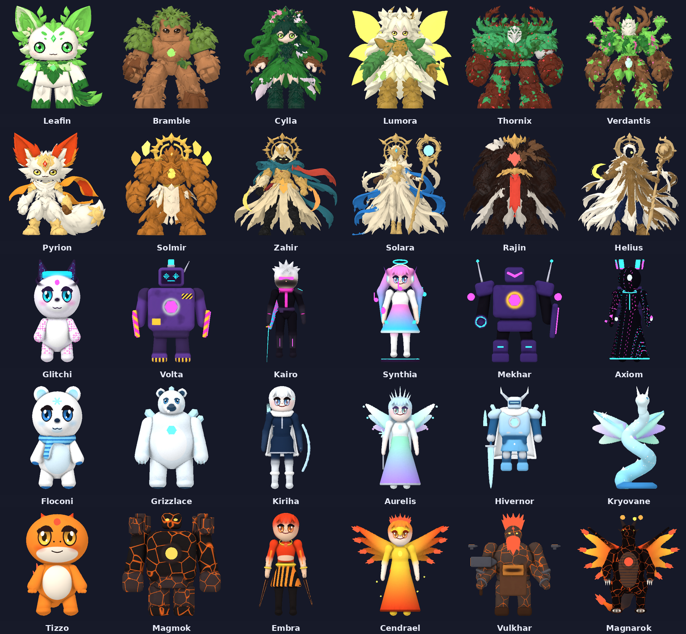

> **Nouveau : [Valoria Champions](valoria/README.md)** — jeu d'aventure chevaleresque façon Anime Champion
> Simulator (héros voxel « petit pixel » à invoquer, village, deux mondes, Tour des Épreuves, deux raids,
> interface façon Pet Simulator 99). Tout est dans le dossier `valoria/`.

# Astral Heist

Jeu Roblox d'aventure « anime cartoon semi-réaliste » : collectionne 30 héros sur cinq îles flottantes, expose-les
dans ta base pour produire de l'énergie, vole ceux des autres joueurs en duel, et profite des tempêtes cosmiques qui
font muter les héros sauvages. Conçu d'abord pour le mobile (HUD tactile), jouable au clavier et à la manette.

Ce dépôt contient **tout le code du jeu** (serveur, client, configuration), **le monde généré** (hub + 5 îles),
**les 30 modèles 3D de héros** prêts à importer et les outils qui les ont produits.



## Démarrage rapide

1. Installer [Rojo 7.6](https://rojo.space/) (CLI + plugin Studio).
2. Construire la place :
   ```bash
   rojo build default.project.json -o build/AstralHeist.rbxl
   ```
   puis l'ouvrir dans Roblox Studio. (Pour travailler en direct : `rojo serve` + plugin Rojo.)
   Une place déjà construite est fournie : `build/AstralHeist.rbxl`.
3. Dans Studio : **Paramètres du jeu > Sécurité > Activer l'accès de Studio aux services d'API** (sauvegarde).
4. **Importer les modèles des héros** (voir ci-dessous), puis **Jouer**.

Sans modèles importés, le jeu fonctionne quand même : chaque héros manquant est remplacé par une figurine
procédurale aux couleurs de sa palette.

## Importer les 30 héros

Les modèles sont dans `assets/heroes/<Héros>/` : `<Héros>.glb` (maillages + textures PBR intégrées),
`<Héros>_color.png`, `<Héros>_normal.png` et `<Héros>.json` (manifeste du rig).

Pour chaque héros :

1. Studio > **Fichier > Importer en 3D**, choisir `assets/heroes/<Héros>/<Héros>.glb`.
2. Garder les options par défaut (un modèle, pièces séparées) et importer.
3. Renommer le modèle importé exactement comme l'identifiant du héros (`Leafin`, `Glitchi`, `Magnarok`…).
4. Le déplacer dans **ReplicatedStorage > Assets > HeroModels**.

Ne renommez pas les MeshParts (`Body`, `Head`, `ArmL`, `Tail`, `WingL`, `Body_Glow`…) : `HeroModelFactory` s'en sert pour
mettre le modèle à l'échelle, poser les Motor6D aux pivots du manifeste (`Visuals/HeroRigs.luau`) et animer
procéduralement chaque héros selon son kit (repos, marche, course, saut, attaque, compétence, alerte). Les pièces
`*_Glow` passent automatiquement en Néon.

Le détail (dépannage, ordre conseillé, vérifications) est dans [docs/GUIDE.md](docs/GUIDE.md).

## Contenu du dépôt

| Dossier | Rôle |
| --- | --- |
| `src/ReplicatedStorage/Shared/Config` | Tout l'équilibrage : héros, raretés, îles, compétences, ennemis, tempêtes, mutations, bannières, économie, quêtes, boutique, audio |
| `src/ReplicatedStorage/Shared/Logic` | Formules pures (production, puissance, gacha + pitié, paliers de vol, profil joueur) |
| `src/ReplicatedStorage/Shared/Visuals` | Fabrique de modèles de héros, animateur procédural, effets de rareté/mutations, ennemis procéduraux, bibliothèque de VFX |
| `src/ServerScriptService/Server/Services` | 21 services serveur (données, monde, combat, ennemis, apparitions, capture, vol, tempêtes, boss, invocation, boutique, échanges…) |
| `src/ServerScriptService/Server/World` | Générateur du monde : terrain des îles, hub et ses 12 bases, ponts, monuments, décor (pack Nature) |
| `src/StarterPlayer/StarterPlayerScripts/Client` | Client : HUD, pavé de combat, menus, rendu 3D des héros, ambiances, cinématiques |
| `src/ReplicatedFirst` | Écran de chargement |
| `assets/heroes` | 30 héros convertis/générés (GLB, textures, manifestes) |
| `assets/nature/NaturePack.rbxm` | Pack Nature 480, corrigé pour Rojo (placé dans ServerStorage) |
| `tools/hero_pipeline` | Pipeline 3D : conversion des FBX (12 premiers héros) et modeleur procédural SDF (18 autres) |
| `tools/tests` | Tests unitaires Luau de la logique partagée |
| `docs` | Guide détaillé et aperçus |

## Ce qui est en place

- **Boucle principale** : capture ou récolte des héros sauvages, transport instable jusqu'à la base, exposition sur
  les socles, collecteur d'énergie, production hors ligne, améliorations de base.
- **Vol de base** : duel chronométré contre le héros exposé (paliers Or / Argent / Bronze), défense par la victime,
  interception du voleur, vengeance, protections anti-frustration, camps de Pilleurs PNJ.
- **Combat** : attaque (maintenir = enchaîner) et trois compétences du leader (rôle, élément, signature), trois
  assistants visibles qui lancent leur compétence de rôle réduite, zones rouges télégraphiées, mobs avec effets
  propres (ralentissement, gel, bouclier frontal, explosion à la mort), gardiens de sanctuaire, boss mondiaux à trois
  phases (fragments du Spectre Prisme), récompenses selon la contribution (dégâts, soins, boucliers).
- **Tempêtes cosmiques** : 7 tempêtes avec ciel, particules et mutations ; grandes tempêtes du week-end ; boost de
  serveur affiché sur l'Horloge cosmique ; bilan personnel en fin de tempête.
- **Événements d'îles** : tempête de sable (Désert), coupures de courant (Ville Néon), blizzard et sources chaudes
  (Glacier), éruptions avec pluie de météores et cristaux de magma, jauge de chaleur (Volcan).
- **Méta** : invocation avec taux affichés, pitié et étoiles ; index et collection de titres (dont « Justicier ») ; quêtes guidées, quotidiennes,
  hebdomadaires, contrats ; calendrier de connexion ; échanges sécurisés ; boutique (gamepasses, produits, cosmétiques).
- **Monde** : hub (plaza, flèche astrale, horloge cosmique, 12 bases, Mur des légendes avec classements du serveur
  et de la saison) et cinq îles thématiques avec leurs monuments, balises de téléportation, portes à débloquer,
  monorail et tyroliennes de la Ville Néon, Forge des Titans, énigme quotidienne de la Pyramide, monuments qui
  réagissent à la collection (obélisques, héros gelés, cadran de l'Éclipse), cerf de cristal, routes sur chaque île,
  cycle jour/nuit et éclairage propre à chaque île.
- **Interface** : HUD mobile (colonne de menus de la bible, cibles tactiles agrandies), mini-carte et carte
  indépendantes du streaming, plaque pseudo/titre/rang au-dessus des avatars, notifications, annonces serveur,
  cinématique d'arrivée, objectif guidé.
- **Langues** : textes source en français ; langue « Auto » (celle du compte Roblox) par défaut. Une table de
  localisation Roblox (`src/LocalizationService/Interface.csv`, générée par `tools/localization/make_csv.py`) traduit
  244 textes d'interface et messages en anglais, espagnol et portugais ; le reste (phrases construites, descriptions
  de héros) passe par la traduction automatique de Roblox à activer dans le Creator Hub (voir le guide).

## Tests

```bash
python3 tools/tests/run_tests.py      # nécessite la CLI luau (variable LUAU ou PATH)
```

## Régénérer les modèles

```bash
python3 tools/hero_pipeline/run_sdf_heroes.py          # 18 héros procéduraux (îles 3 à 5)
python3 tools/hero_pipeline/make_rigs.py               # met à jour Visuals/HeroRigs.luau
```

Dépendances Python : `numpy scipy scikit-image xatlas fast-simplification pillow`.
