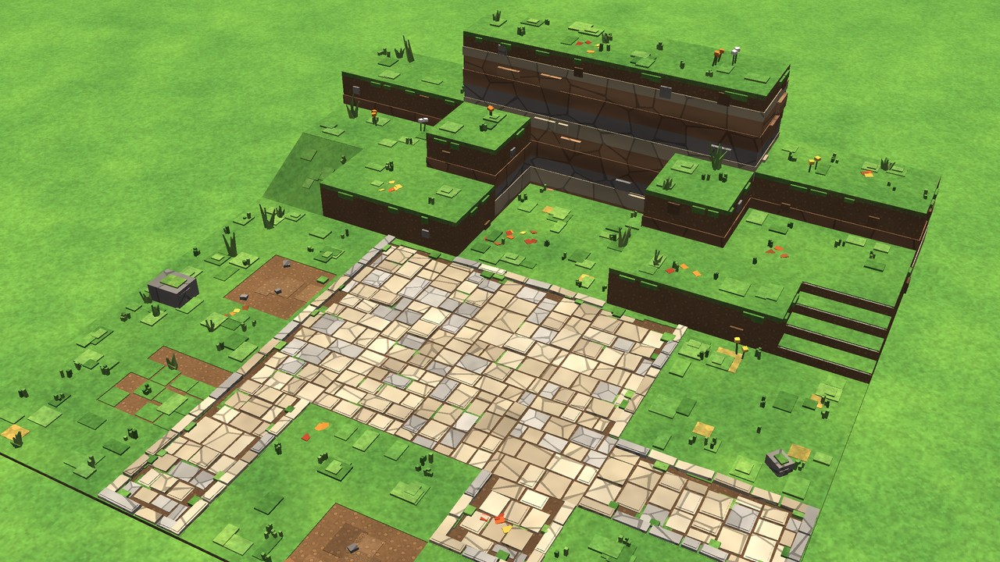
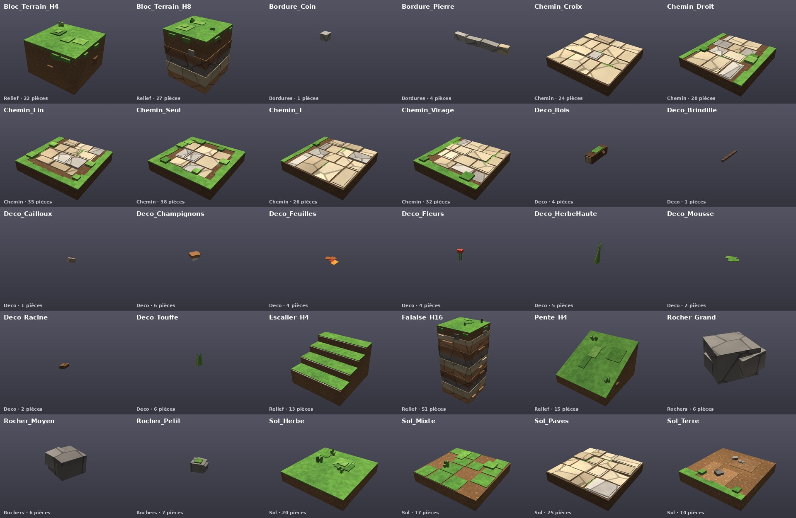
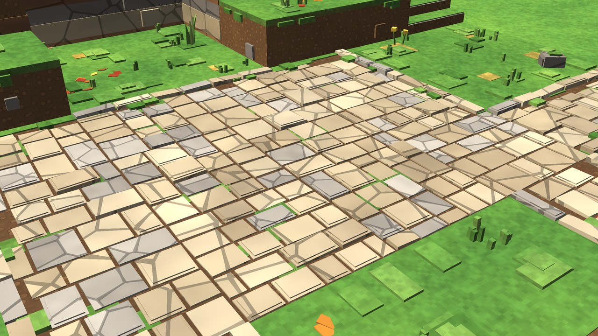
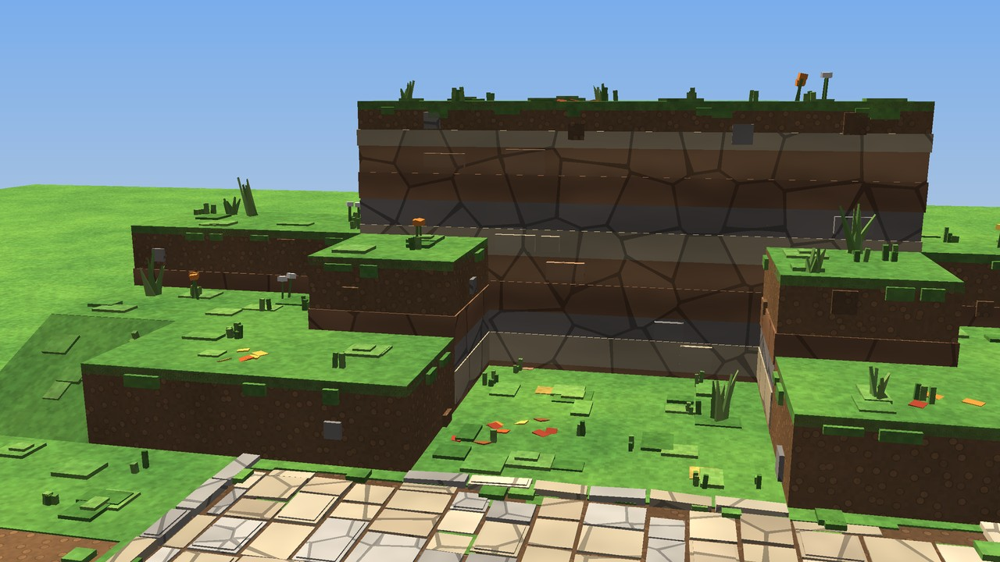
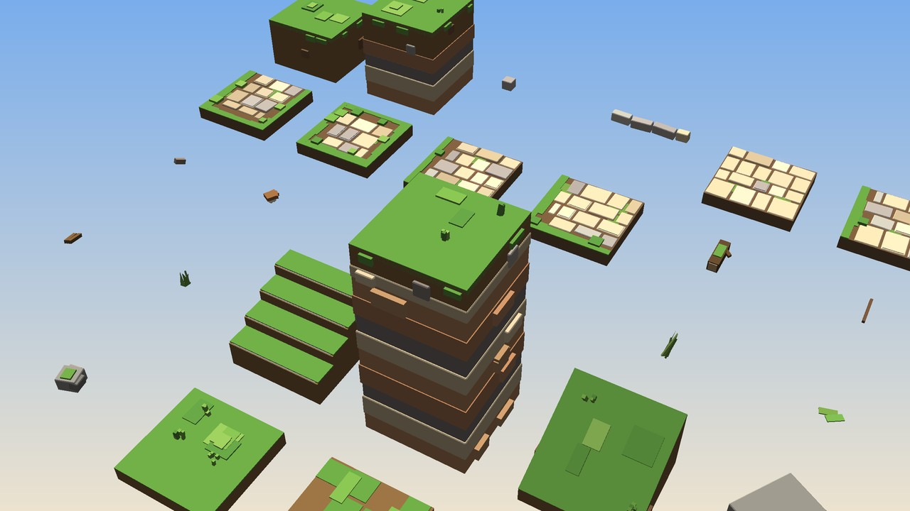

# Kit de sol modulaire — Val d'Automne

Kit de modules 3D pour Roblox Studio : sols, chemins pavés, bordures, relief, rochers et décor du monde 1 de
**Valoria Champions**. C'est la base de la direction artistique « voxel soigné » du jeu : formes cubiques
lisibles, blocs visibles sans effet « gros pixel », matériaux réalistes stylisés, couleurs naturelles
légèrement saturées.

Le même code construit le kit pour Studio et le sol du jeu : le camp du Val d'Automne est assemblé avec ces
modules (`src/ServerScriptService/Server/World/GroundKit.luau` et `GroundLayout.luau`).



## Contenu du dossier

| Fichier | Rôle |
| --- | --- |
| `ValoriaKit_ValDAutomne.rbxmx` | Le kit pour Roblox Studio : 77 modèles (30 modules, 1 à 3 variantes chacun), la zone de démonstration assemblée, le module `Disposition` (plan → modules) et le script `Assembleur` |
| `obj/` | Un fichier `.obj` par modèle, `kit_complet.obj` (variantes A en grille, un objet par module), `valoria_kit.mtl` (un seul matériau) et `textures/atlas.png` (une case de 32 × 32 pixels par teinte de la palette) |
| `apercus/` | Planche des modules, trois vues de la zone de démonstration, contrôle de l'export OBJ |
| `donnees/bilan.json` | Nombre de pièces par module et par couche de la zone de démonstration |

Tout est généré par du code et vérifié automatiquement (voir **Vérifications**). Il n'y a pas de fichier
FBX : aucun outil d'export FBX n'est disponible ici. L'OBJ est accepté par l'importateur 3D de Roblox Studio.

## 1. Direction artistique

- **Lisibilité Roblox** : volumes simples, silhouettes cubiques, aucun détail plus fin qu'environ 0,1 stud.
- **Voxel 3D** : herbe sur terre comme un bloc (dessus d'herbe, flancs de terre, gouttes d'herbe sous le
  rebord), falaises en couches de roche, rochers cubiques arrondis, brins d'herbe en petits pavés verticaux.
- **Matériaux** : matériaux Roblox (2022, activés dans la place) avec des couleurs de palette ; mêmes
  familles partout pour que les modules restent cohérents.
- **Biseaux discrets** : une pierre sur trois reçoit un chapeau légèrement en retrait (version en pièces) ;
  dans l'OBJ, les pierres et rochers sont réellement chanfreinés (0,06 stud).

Palette (définie dans `src/ReplicatedStorage/Shared/Config/Palette.luau`) :

| Famille | Couleurs (RVB) | Matériau Roblox |
| --- | --- | --- |
| Herbe | 92 148 60 (base) · 106 162 68 · 78 130 52 · 124 174 78 | Grass |
| Herbe sèche | 190 164 76 · 172 150 68 | LeafyGrass |
| Mousse | 84 132 54 · 100 146 60 | LeafyGrass |
| Terre | 122 88 56 (base) · 108 78 50 · 136 100 64 ; joints 82 60 42 | Ground |
| Pavés beiges | 214 198 164 · 200 184 150 · 224 210 178 · 190 172 140 | Limestone |
| Pavés gris clair | 182 178 168 · 168 164 156 | Slate |
| Roche | 134 130 124 · 118 114 110 · 150 144 136 | Rock |
| Strates | 176 128 86 · 198 180 142 · 132 126 120 · 160 112 76 | Sandstone, Limestone, Rock |
| Feuilles d'automne | 224 112 40 · 198 66 42 · 238 184 62 · 214 142 50 | SmoothPlastic |
| Bois | 110 78 50 · 92 64 42 | Wood |
| Fleurs | 240 82 92 · 250 210 80 · 250 248 236 · 172 122 232 | SmoothPlastic |

L'herbe et la terre de base ont **une seule teinte** pour toutes les dalles : aucun quadrillage n'apparaît
aux raccords, la variété vient des mottes, des brins, des taches et des pierres.

## 2. Grille et dimensions

| Règle | Valeur |
| --- | --- |
| Dalle | 8 × 8 studs ; repère local : centre de la dalle, sol à y = 0, nord = -Z |
| Collision des sols | dessus de la semelle à **y = 0,26** (semelle de 1,2 stud enterrée de 0,94) |
| Dessus visible | **y = 0,33** (herbe, pavés) ; terre battue à 0,26 |
| Joints | 0,18 stud entre deux pierres ; 0,09 jusqu'au bord de la dalle |
| Chemin | 8 studs de large ; pavés jusqu'au bord sur les côtés raccordés, bord irrégulier (0,8 à 1,5 stud d'herbe et de terre) ailleurs |
| Blocs surélevés | 4, 8 et 16 studs (dessus à H + 0,26 pour la collision, H + 0,33 visible) |
| Pente | 4 studs sur 8 (26,6°, praticable) ; escalier : 4 marches d'un stud |
| Strates | limites communes à tout le kit (−0,9 ; 0,7 ; 2,5 ; 3,9 ; 5,7 ; 7,3 ; 8,9 ; 10,5 ; 12,1 ; 13,7 ; 15,3…) : les couches de deux blocs voisins se prolongent |
| Emprise | sols, chemins, bordures : rien ne dépasse de la dalle ; relief : gouttes d'herbe, strates et saillies rocheuses jusqu'à 0,4 stud ; rochers et décor : posés librement |

Une grille de 8 studs et des rotations de 90° suffisent pour tout assembler. Les sols n'ont pas de faces
confondues aux raccords : les bandes d'herbe des quatre côtés ont des hauteurs décalées de quelques
millièmes, les pierres s'arrêtent avant le bord.

## 3. Modules

| Module | Groupe | Description | Variantes | Pièces |
| --- | --- | --- | --- | --- |
| `Sol_Herbe` | Sol | Dalle d'herbe, mottes et brins en relief | 3 | 17 |
| `Sol_Mixte` | Sol | Transition terre / herbe par plaques | 3 | 15 |
| `Sol_Paves` | Sol | Place pavée (pavés sur toute la dalle) | 3 | 28 |
| `Sol_Terre` | Sol | Terre, taches, cailloux, un bord herbeux | 3 | 13 |
| `Chemin_Croix` | Chemin | Croisement : raccords sur les quatre côtés | 2 | 24 |
| `Chemin_Droit` | Chemin | Tronçon droit : raccords nord et sud | 2 | 30 |
| `Chemin_Fin` | Chemin | Extrémité : raccord au nord | 2 | 31 |
| `Chemin_Seul` | Chemin | Dalle pavée isolée | 2 | 38 |
| `Chemin_T` | Chemin | Embranchement en T : nord, est, sud | 2 | 25 |
| `Chemin_Virage` | Chemin | Virage : nord et est | 2 | 30 |
| `Bordure_Pierre` | Bordures | Bordure de pierres le long du côté nord | 2 | 4 |
| `Bordure_Coin` | Bordures | Pierre d'angle (coin nord-ouest) | 2 | 1 |
| `Bloc_Terrain_H4` | Relief | Bloc de 4 studs : herbe sur terre | 2 | 22 |
| `Bloc_Terrain_H8` | Relief | Bloc de 8 studs : terre puis couches rocheuses | 2 | 25 |
| `Falaise_H16` | Relief | Falaise de 16 studs en strates, saillies rocheuses | 2 | 50 |
| `Pente_H4` | Relief | Pente praticable, monte vers le nord | 2 | 15 |
| `Escalier_H4` | Relief | Quatre marches, montent vers le nord | 2 | 13 |
| `Rocher_Petit` / `_Moyen` / `_Grand` | Rochers | Rochers cubiques d'environ 1,6, 3,4 et 5 studs | 3 | 5 à 6 |
| `Deco_Touffe`, `Deco_HerbeHaute`, `Deco_Fleurs`, `Deco_Feuilles`, `Deco_Cailloux`, `Deco_Champignons`, `Deco_Mousse`, `Deco_Racine`, `Deco_Bois`, `Deco_Brindille` | Deco | Décor facultatif, séparé du sol | 3 | 1 à 6 |

« Pièces » : nombre moyen de pièces Roblox par modèle dans la version `.rbxmx`.



## 4. Assembler une zone

Une zone se décrit par un **plan texte** : une lettre par dalle, première ligne au nord.

| Lettre | Module |
| --- | --- |
| `.` | rien |
| `h` `t` `m` `p` | Sol_Herbe, Sol_Terre, Sol_Mixte, Sol_Paves |
| `#` | chemin : le module (droit, virage, T, croix, fin, seul) et sa rotation sont choisis d'après les voisins `#` et `p` |
| `4` `8` `F` | Bloc_Terrain_H4, Bloc_Terrain_H8, Falaise_H16 |
| `/` `e` | Pente_H4, Escalier_H4 : tournés pour monter vers le bloc surélevé voisin |
| `r` `R` `G` | rocher petit, moyen, grand, posé sur une dalle d'herbe |

Options : `bordures` (bordures de pierre le long des côtés de chemin qui donnent sur l'herbe) et `deco`
(0 à 2 éléments de décor par dalle, rangés dans un dossier à part). La zone de démonstration :

```
8 8 F F F F 8 8
4 4 8 h h 8 4 4
/ 4 4 h h 4 4 e
h h # # # # h h
h t # p p # h r
R h # p p # # #
h m # h h # h h
h h # h t h G h
```

| | |
| --- | --- |
|  |  |

## 5. Dans Roblox Studio

### Version en pièces (`.rbxmx`, prête à l'emploi)

1. Dans l'Explorateur, clic droit sur **ServerStorage** > **Insérer depuis un fichier…** (Insert from File),
   choisir `ValoriaKit_ValDAutomne.rbxmx`.
2. Le dossier `ValoriaKit_ValDAutomne` contient `Sol`, `Chemin`, `Bordures`, `Relief`, `Rochers`, `Deco`
   (modèles `Module_A`, `Module_B`…), `ZoneDemo` et les scripts.
3. **Assembler automatiquement** : dans la barre de commande (Affichage > Barre de commande) :

   ```lua
   local A = require(game.ServerStorage.ValoriaKit_ValDAutomne.Assembleur)
   A.Construire([[
   h h # h h
   h # # # h
   h h # h h
   ]], CFrame.new(0, 0, 0), workspace, { bordures = true, deco = true })
   ```

4. **À la main** : régler le déplacement par pas de 8 studs et la rotation par pas de 90° (onglet Modèle),
   glisser des modèles dans le Workspace. Chaque modèle a sa semelle comme `PrimaryPart`.
5. Pour une zone sans décor, supprimer le dossier `Deco` de la zone assemblée.

### Version maillages (`obj/`, MeshParts)

1. **Fichier > Importer 3D** (Import 3D), choisir un `.obj` du dossier `obj/` (garder `valoria_kit.mtl` et
   `textures/atlas.png` à côté).
2. Échelle 1 (1 unité = 1 stud), Y vers le haut.
3. Après import : `CollisionFidelity = Box` et `CanCollide` seulement pour les sols, `CanCollide = false`,
   `CanQuery = false` et `CastShadow = false` pour le décor.

Tous les modules partagent un seul matériau et une seule texture (l'atlas) : une dalle de chemin devrait
devenir une seule MeshPart au lieu de 25 à 38 pièces, et l'atlas n'est chargé qu'une fois.
**Je n'ai pas pu tester cet import dans Studio** (pas de Studio ici). Les fichiers ont été relus et rendus
(voir ci-dessous), mais le résultat de l'importateur reste à vérifier dans Studio.

## 6. Collisions et performances

- **Collisions simples** : seules les semelles (8 × 8) et les volumes des blocs, pentes et escaliers ont une
  collision. Pierres, herbe, bordures, petits rochers et décor n'en ont pas.
- **Décor** : sans collision, sans requête de rayon, sans ombre ; rangé à part, il peut être retiré ou
  allégé.
- **Pièces** : de 13 (terre) à 38 (chemin isolé) par dalle ; la zone de démonstration (64 × 64 studs)
  compte 1 776 pièces, dont 189 de décor. En jeu, le sol du camp du Val en compte 1 746, dont 283 de décor.
- **Streaming** : chaque module est un `Model` en `ModelStreamingMode = Atomic` (chargé d'un bloc).
- **Aucun script permanent** : rien ne tourne pour le décor du kit. Les détails au sol du terrain (herbe,
  cailloux…) sont posés côté client autour du joueur, avec une portée selon la qualité graphique.
- **Pour aller plus loin** : dans la version OBJ, chaque module devient une MeshPart (une dalle de sol ou de
  chemin : 13 à 38 pièces remplacées par une seule) ; en Studio, le niveau de détail des modèles (`LevelOfDetail = StreamingMesh`) peut
  être activé sur les grandes zones (propriété absente des définitions de types pour les scripts : à régler
  dans Studio).

## 7. Vérifications

`tools/kit/export_kit.luau` relit le `.rbxmx` qu'il vient d'écrire et vérifie :

- les 77 modèles sont présents, ancrés, avec une `PrimaryPart` et une collision pour les sols et le relief ;
- aucune pièce de sol, de chemin ou de bordure ne dépasse de la dalle ; le relief reste dans sa tolérance ;
- le décor n'a ni collision, ni requête, ni ombre ;
- le script `Assembleur` du fichier, exécuté tel quel, pose les 126 modules de la zone de démonstration, à la
  bonne hauteur.

`tools/kit/export_obj.py` relit chaque `.obj` : indices des sommets, coordonnées de texture (dans l'atlas)
et normales valides, emprise des dalles, matériau unique. `apercus/controle_obj.jpg` est rendu à partir du
fichier `kit_complet.obj` relu, couleurs lues dans l'atlas.



## 8. Régénérer

Depuis `valoria/` (Lune et Python 3 avec numpy et Pillow) :

```bash
lune run tools/kit/export_kit.luau kit      # .rbxmx, données, vérifications
python3 tools/kit/export_obj.py kit         # OBJ, MTL, atlas, vérifications
python3 tools/kit/kit_views.py kit          # aperçus
```

Pour un nouveau monde : dupliquer la palette dans `Palette.luau` (une entrée par monde) et donner à
`GroundKit` la palette voulue. La grille, les raccords et l'assembleur restent les mêmes.
